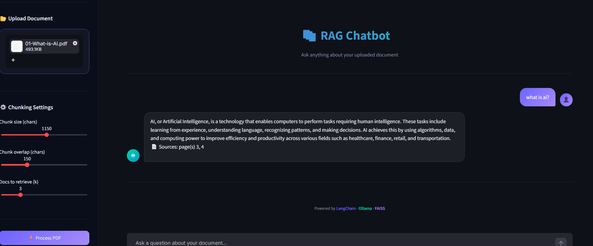

# RAG Document Search

A local Retrieval-Augmented Generation (RAG) chatbot that lets users upload a PDF, process its content, and ask questions about the document. Answers include source-page references to help users locate the relevant information.

## Streamlit App Preview



*Example: upload a PDF, process it, and ask a question. The chatbot returns an answer with the source pages used.*

## Features

- **PDF upload:** Upload a PDF through the Streamlit sidebar.
- **Configurable text chunking:** Adjust chunk size and chunk overlap to control how the document is split into smaller passages.
- **Retrieval control:** Choose how many relevant chunks to retrieve (`k`) for a question.
- **Local document processing:** Extract PDF text, split it into chunks, create embeddings, and store them in a FAISS vector index.
- **Question answering:** Ask questions about the uploaded document and receive answers grounded in retrieved passages.
- **Source references:** Display the page numbers associated with the retrieved information.

## How It Works

1. Upload a PDF.
2. Adjust the chunk size, chunk overlap, and number of chunks to retrieve, if needed.
3. Click **Process PDF** to extract, split, embed, and index the document.
4. Enter a question about the document.
5. Read the generated answer and check the cited source pages.

## Technology Stack

- Python
- Streamlit
- LangChain
- Ollama for local language-model and embedding workflows
- FAISS for vector search
- PDF text extraction

## Run Locally

1. Clone or download this repository.
2. Open the project folder in VS Code.
3. Create and activate a virtual environment:

   ```bash
   python -m venv .venv
   ```

   Windows PowerShell:

   ```powershell
   .\.venv\Scripts\Activate.ps1
   ```

4. Install dependencies:

   ```bash
   pip install -r requirements.txt
   ```

5. Ensure Ollama is installed and the model(s) required by the application are available locally.
6. Start the app:

   ```bash
   streamlit run app.py
   ```

7. Open the local URL printed in the terminal, usually `http://localhost:8501`.

## Performance Note

This project uses local processing, so PDF processing and answer generation may take more than a minute depending on the document size, the selected chunking settings, the local model, and the computer's available resources. For faster responses, the application can be adapted to use a hosted model API such as Google Gemini; this requires configuring an API key and updating the application accordingly.

For best results with the local setup, start with a short PDF and increase the document size gradually.

## Limitations

- Answer quality depends on the text extracted from the PDF and the relevance of retrieved chunks.
- Large PDFs and smaller chunk sizes can increase processing time.
- A generated answer should be checked against the cited source pages for important decisions.

## Project Structure

```text
RAG-Document-Search/
├── app.py
├── requirements.txt
├── README.md
└── rag-chatbot-demo.png
```

*The exact files may vary depending on the current project version.*

## Future Improvements

- Add support for additional document formats.
- Improve retrieval with hybrid keyword and semantic search.
- Add document-level caching to avoid repeating work for the same PDF.
- Offer a hosted API option for faster generation when an API key is configured.
